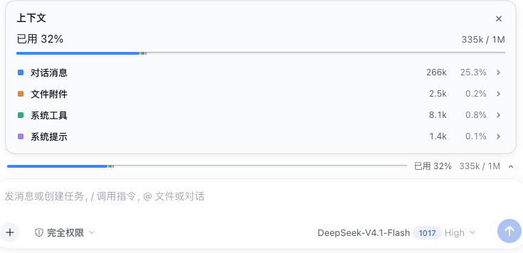
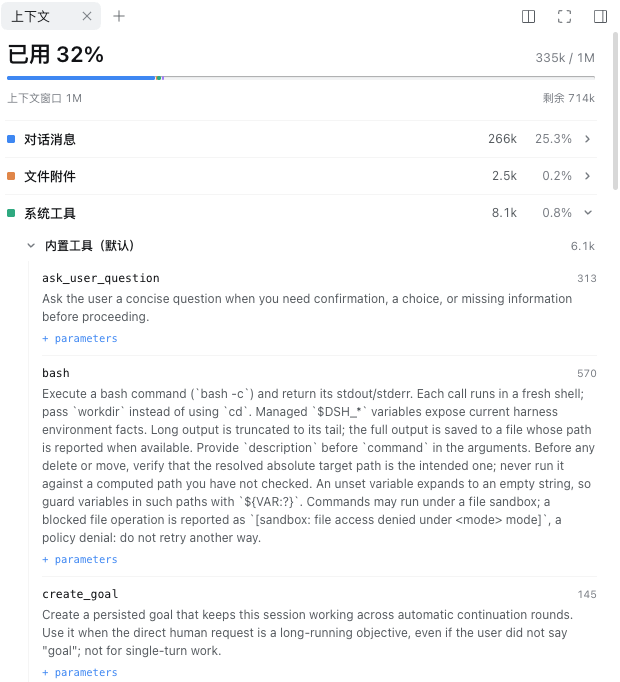
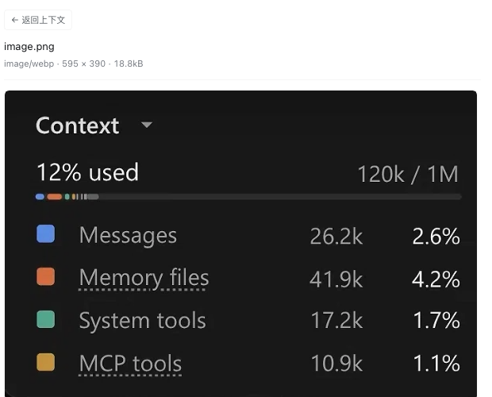

# dsh-context-bar

[](LICENSE)
[](package.json)
[](package.json)
[](https://github.com/kakaCat/dsh-context-bar)

DeepSeek Harness（DSH）插件：在输入框上方（与 Todo 同一个 dock 区）显示当前模型上下文窗口的分段用量条；点开面板看分类占比，点分类在右侧 Sidebar 的「上下文」标签页里查看真正发给模型的内容。

灵感来自 Claude Code 的 `/context` 面板；Claude Code 是 Anthropic 的产品，本插件与 Anthropic 官方无关。

## 界面预览

真机截图（DSH 0.2.1-rc.5，浅色主题）：

| 折叠态 | 展开态 |
|---|---|
|  |  |

| 右侧栏：分类内容 | 右侧栏：附件预览 |
|---|---|
|  |  |

## 特性

- **折叠态**：一条细分段条 + `已用 N%` + `已用 / 窗口`，与输入框同宽。
- **展开态**：点条形打开面板，列出「对话消息 / 文件附件 / 系统工具 / MCP 工具 / 系统提示」的 tokens 与占窗口百分比；点面板外或按 `Escape` 收起（焦点回到条形）。
- **右侧 Sidebar 上下文检查器**：点分类打开 DSH 右侧栏「上下文」标签页，并按分类懒加载实际内容：
  - 系统提示词全文；
  - 系统工具 / MCP 工具按命名空间、server 分组，展开可看完整 `parameters` schema；
  - 对话消息（角色、tokens；tool-call 入参与 tool 结果折叠展示）；
  - 文件附件：图片内联预览、文本内联展示、二进制显示元信息，标签页内可返回；
  - 技能：技能摘要与全文。
- **口径与 token-meter 一致**：Host 半投影 `contextBreakdownDetailed`，折叠与 token-meter 相同的 durable surface 事件；compaction 阴影价会被扣除并计入替换。
- **降级安全**：Host 半不可用时，Client 回退到内置的 3 段 `contextBreakdown`（对话 / 系统提示 / 工具）；占用或窗口未知时整条隐藏。
- **无 LLM 调用**：token 全部是本地固定密度估算；内容按需从本地会话日志读取。

## 显示口径

```
上下文 ▾
12% used                          120k / 1M
[■■■■■■■■■■■■■■■■■■■■■■■■■■■■■■■■]   （分类段 + 剩余轨道）
■ 对话消息                          187.2k    18.7%
■ 文件附件                           41.9k     4.2%
■ 系统工具                           17.2k     1.7%
■ MCP 工具                           10.9k     1.1%
■ 系统提示                            9.1k     0.9%
```

| 量 | 口径 |
|---|---|
| 100% | 当前解析到的模型路由的完整 `contextWindow` |
| 总占用 | token-meter 投影的 `projectedTokens ?? pressureTokens` |
| 每行百分比 | `categoryTokens / contextWindow`，同一分母，不缩放 |
| 分类来源 | 本 bundle 的 Host 投影 `contextBreakdownDetailed`；系统提示词=最后一条非空存活 `system/message`；系统工具/ MCP 工具=最新 request envelope 的工具 schema（按 `mcp__` 前缀拆分）；文件附件=durable image/file 块的结构价；对话消息=其余可见消息文本 |

所有 token 都是 DSH 固定密度启发式的**显示估算**（chars/4 + block overhead），不是账单数据。

## 安装

前置要求：

- Node.js ≥ 20；
- DSH ≥ `0.2.1-rc.5`（由 `engines.dsh` 在安装与启动时校验），Web UI（`dsh web` 或 Desktop）；
- 本插件是纯 JS、无第三方依赖、**无需构建**。

**方式一：从源码 checkout 装进 profile（推荐）**

```sh
git clone https://github.com/kakaCat/dsh-context-bar.git
dsh plugin --profile <profile> add /path/to/dsh-context-bar
```

**方式二：让 Agent 用 `plugin_manager` 安装**

> 请用 plugin_manager 的 `install_bundle`，target 传本仓库的绝对路径。

装好后重启 Host（Host 半只在启动时加载），再刷新页面（Client 半）。插件清单里出现 `dsh-context-bar` 即为成功，输入框上方会出现分段条。

卸载：

```sh
dsh plugin --profile <profile> remove dsh-context-bar
```

## 使用

- 点条形展开/收起面板；点面板外任意位置或按 `Escape` 收起。
- 点面板里的分类 → 右侧 Sidebar 打开「上下文」标签页并自动展开该分类。
- 点附件行 → 在标签页内预览，点「← 返回上下文」回到列表。

## 内容与上限

| 分类 | 内容 | 上限 |
|---|---|---|
| 系统提示词 | 最近一条非空 durable `system/message` | — |
| 系统工具 | 最新 request envelope 中非 `mcp__*` 工具的名称、完整描述、`parameters` | — |
| MCP 工具 | `mcp__<server>__<tool>` schema，按 server 分组 | — |
| 对话消息 | 最近的 user / assistant / tool / developer 事件，正文截断 | 40 条、正文 6000 字符 |
| 文件附件 | durable image / file 块；按 `attachmentId` 从附件对象存储读取 | 60 个、预览 12MB |
| 技能 | skills registry 的摘要与全文 | 40 个 |

右侧「技能」行只统计技能描述的估算 tokens，不计入条形图，因此该行显示 `—` 而非百分比。

## 数据与隐私

- 只读当前 DSH profile 的本地会话日志（系统提示词、工具 schema、消息、附件、技能），**不写会话数据**。
- **无 LLM 调用、无网络外发**；不采集遥测。
- 内容通过同源本地路由 `/api/context-bar.ui` 与 `/api/context-bar.file` 按需读取，与 DSH 其他 Web 路由同一套鉴权。
- 附件预览只按 content-addressed `attachmentId` 经 DSH `attachments` 服务读取对象存储；**不跟随**会话事件里的任何文件路径，也不遍历工作区文件；预览上限 12MB。
- **本地可信边界**：能访问本机 DSH Web 的客户端可以按 `sessionId` 读取该 profile 的会话内容（与官方 `/export` 同级的信任模型），不要把 DSH Web 暴露到不可信网络。

## 兼容性

| 项 | 要求 |
|---|---|
| DSH | `>=0.2.1-rc.5 <0.3.0`（`engines.dsh`，不满足时安装与启动会拒绝） |
| Node.js | ≥ 20 |
| 平台 | DSH Web UI（`dsh web` / Desktop），Client 半 `platform: web` |
| 右侧 Sidebar | 可选；服务缺失时分类点击降级为无操作，条形图与面板仍可用 |
| token-meter | 使用其 `contextPressure` / `contextBreakdown` 投影（`dsh-base` 自带） |

## 已知限制

- DSH 输入框下方内置的紧凑 ContextMeter 是硬编码的，无法通过 dock slot 移除；本插件只在它上方新增一条。
- 技能分类不计入条形图（见「内容与上限」）。
- 估算口径按 chars/4，CJK 文本会被低估；数字只用于判断相对占比。
- 无配置项。
- 本插件依赖 DSH 的会话持久化事件与投影 API，升级 DSH 前请确认兼容范围。

## 开发

```sh
node --check client.js && node --check index.js
node --test        # 42 个单元测试（投影、路由、内容抽取、客户端渲染）
```

仓库结构：

| 路径 | 作用 |
|---|---|
| `index.js` | Host 半：`contextBreakdownDetailed` 投影 + `/api/context-bar.ui`、`/api/context-bar.file` 路由 |
| `client.js` | Client 半：`conversation.input.dock` 条形条 + 右侧 Sidebar「上下文」标签页 |
| `cordis.patch.yml` | bundle patch（插入插件行） |
| `locale/` | 插件展示元数据（en / zh），供插件清单使用 |
| `test/` | `node:test` 单元测试 |
| `docs/design/` | UI 设计稿（v2 / v4 / v5，非产品截图） |

## 贡献

欢迎 issue 与 PR。提交前请确保 `node --check client.js && node --check index.js` 与 `node --test` 通过；CI 会在 Node 22 上跑同样两条命令。

## License

[MIT](LICENSE) © 2026 kakaCat
